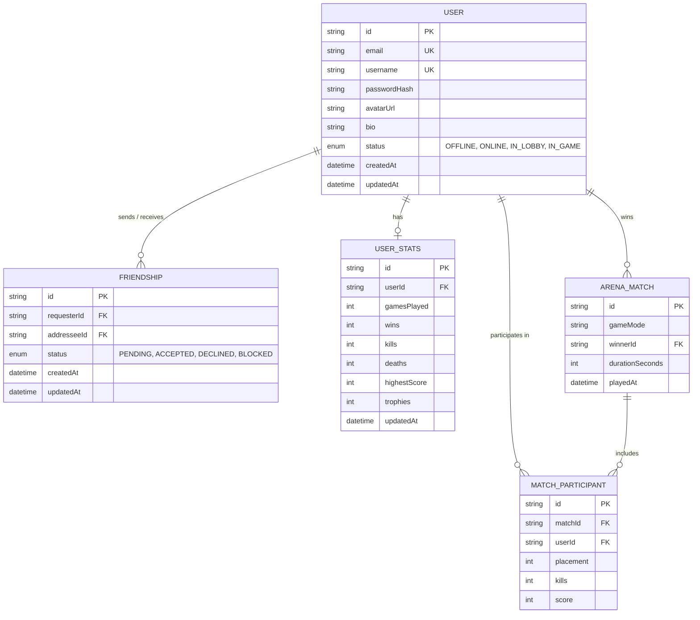

*This project has been created as part of the 42 curriculum by ayhammou.*

# ft_transcendence

## Description
**ft_transcendence** is a real-time multiplayer action arena web game (inspired by battle-royale / IO games like *Warcall.io*). Players fight in live arenas, eliminate opponents, earn XP, and climb the global ladder. The project features a responsive frontend, an API and WebSocket real-time backend, and a relational database managed with Prisma ORM.

### Project Architecture & Ownership
In our 4-person team, this repository provides the core backend services, real-time networking, and user persistence:
1. **Real-time features using WebSockets (Major — 2 pts)**: Arena rooms, live presence, and matchmaking events.
2. **Standard user management (Major — 2 pts)**: Accounts, profiles, hero avatars, and friends system.
3. **Use an ORM for the Database (Minor — 1 pt)**: Prisma ORM with PostgreSQL managing arena matches, participants, and stats.
4. **Game stats & history (Minor — 1 pt)**: Career combat records (Kills, Deaths, Top 1 placements, ELO trophies, match logs).

---

## Instructions

### Prerequisites
- [Docker](https://docs.docker.com/get-docker/) & [Docker Compose](https://docs.docker.com/compose/)
- Google Chrome (latest stable version)
- Make (optional, for convenient commands)

### Quick Start (Single Command Deployment)
1. Clone the repository:
   ```bash
   git clone git@github.com:LLePep/transcendence.git
   cd transcendence
   ```

2. Configure environment variables:
   ```bash
   cp .env.example .env
   ```

3. Launch all services using Docker Compose:
   ```bash
   make
   # or: docker compose up --build -d
   ```

4. Access the web application:
   - **HTTPS Frontend & API:** [https://localhost:8443](https://localhost:8443)
   - *Note on SSL:* A self-signed SSL certificate is automatically generated by Nginx. Accept the self-signed certificate warning in Google Chrome.

5. Useful Makefile Commands:
   - `make logs` : Stream container logs in real time.
   - `make ps` : Check containers health and status.
   - `make down` : Stop all services.
   - `make clean` : Stop services and delete volumes.
   - `make fclean` : Complete cleanup (volumes and Docker images).

---

## Technical Stack

| Layer | Technology | Justification |
| :--- | :--- | :--- |
| **Frontend** | React 18, TypeScript, Vite, Tailwind CSS | Modular components, fast development with HMR, strong typing, modern responsive styling. |
| **Backend** | Node.js, Express, TypeScript | Robust REST API routing, industry standard, broad ecosystem, easy to maintain. |
| **Real-Time** | Socket.IO / WebSockets (WSS) | Persistent bi-directional low-latency communication, auto-reconnection, room broadcasting. |
| **Database** | PostgreSQL 16 | ACID compliance, powerful relational model, robust multi-user concurrency support. |
| **ORM** | Prisma ORM | Type-safe queries, automatic migration management, self-documenting relational schema. |
| **Reverse Proxy**| Nginx (Alpine) | Strict SSL/TLS termination (HTTPS/WSS), routing `/api/`, `/socket.io/`, static uploads and SPA. |
| **Containerization** | Docker Compose | Single-command deployment, reproducible environment across development and evaluation. |

---

## Database Schema



---

## Modules Breakdown (Current Focus: 6 points)

1. **Real-time features using WebSockets (Major — 2 points)**
   - Bi-directional event communication via Socket.IO over HTTPS/WSS.
   - Presence tracking (real-time Online / Offline status for friends).
   - Graceful reconnection and room broadcasting.

2. **Standard user management and authentication (Major — 2 points)**
   - Secure sign-up & log-in with hashed & salted passwords (bcrypt).
   - Profile visualization and customization (username, email, bio).
   - Avatar upload with automatic default fallback.
   - Friend system (send requests, accept/decline, friend list).

3. **Use an ORM for the database (Minor — 1 point)**
   - Prisma ORM integrated with PostgreSQL.
   - Type-safe database queries, schema migrations, and relational integrity.

4. **Game statistics and match history (Minor — 1 point)**
   - Match history records (1v1 matches, date, opponent, final score, winner).
   - User statistics calculation (wins, losses, win rate, progression rating).
   - Global leaderboard.

---

## Team Information & Project Management
- **ayhammou**: Fullstack developer & DevOps
- *Additional team members and specific assigned roles (PO, PM, Tech Lead) will be listed here.*

### Project Management Practices
- **VCS**: Git workflow with descriptive commits.
- **Environment Isolation**: Local `.env` ignored by Git with `.env.example` reference.

---

## Resources & AI Usage
- [Prisma Documentation](https://www.prisma.io/docs)
- [Socket.IO Documentation](https://socket.io/docs/v4/)
- [Vite & React Documentation](https://vitejs.dev/)
- [Tailwind CSS Documentation](https://tailwindcss.com/)
- **AI Usage**: AI was consulted to help design initial architecture skeletons, establish Docker Compose service dependencies, structure relational database schemas, and verify adherence to the subject specifications.
